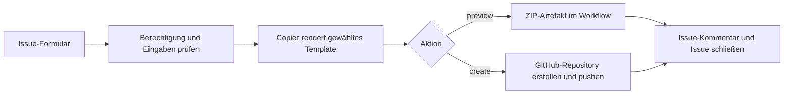

# GitHub Issues × Copier – Repository Factory

Ein Demo-Repository als Self-Service-Einstieg: Issue öffnen, Optionen auswählen,
Workflow erzeugt ein Python-/Java-Projekt oder einen universellen Workflow-Aufruf und legt auf Wunsch ein neues
GitHub-Repository an. Das Copier-Template liegt direkt in diesem Repository.



## Demo lokal ausprobieren

Voraussetzungen: Python ab 3.11 und [uv](https://docs.astral.sh/uv/).

```sh
uv sync
uv run python scripts/automation.py --body examples/preview.md --output output/demo-service
cd output/demo-service
python main.py
python -m unittest discover -s tests
```

Die lokale Ausführung erzeugt ausschließlich Dateien – auch wenn im Beispiel
`create` ausgewählt ist. Ein frisches Zielverzeichnis verwenden.

## Auf GitHub starten

Dieses Projekt als neues Repository hochladen (die GitHub CLI muss angemeldet sein):

```sh
git init -b main
git add .
git commit -m "Add issue-driven Copier demo"
gh repo create template-copier-demo --private --source=. --remote=origin --push
```

Actions müssen aktiviert sein. Unter **Issues → New issue → Python-Repository mit Copier erstellen** eine Anfrage erstellen. Für den ersten Durchlauf `preview` wählen.
Nach erfolgreicher Verarbeitung enthält der Kommentar einen Link zum Workflow;
dort steht das Artefakt `copier-preview` zum Download bereit. Vorschauen benötigen
kein zusätzliches Secret.

Für `create` unter **Settings → Secrets and variables → Actions** konfigurieren:

| Einstellung | Bedeutung |
| --- | --- |
| Secret `REPO_FACTORY_TOKEN` | Token mit Berechtigung zum Erstellen und Befüllen der Ziel-Repositories |
| Variable `TARGET_OWNER` | Optional: GitHub-Benutzer oder Organisation; Standard ist der Besitzer dieses Demo-Repositories |

Für eine einfache Demo im persönlichen Account eignet sich ein **classic PAT**
mit `repo` und zusätzlich `workflow`, wenn CI generiert wird. Das Token muss zum
Zielkonto gehören. Für eine Organisation muss das Konto Repositories erstellen
dürfen; gegebenenfalls ist eine SSO-Autorisierung erforderlich. Das Token wird für Erstellung, Push und die optionale Sonar-Konfiguration neuer Repositories verwendet. Der normale `GITHUB_TOKEN`
verarbeitet Issue-Kommentare und kann keine neuen Repositories außerhalb des
Workflow-Repositories verwalten.

Eine private Demo vermeidet, dass fremde Personen Anfragen stellen. Auch bei einem
öffentlichen Repository prüft die Automation vor jeder Aktion die aktuellen
Schreibrechte des auslösenden Benutzers. Tokens niemals in Issues eintragen.

## Was lässt sich konfigurieren?

| Issue-Feld | Ergebnis |
| --- | --- |
| Aktion: `preview` / `create` | Dateien als Artefakt oder neues Repository |
| Repository-Name | GitHub-Name, README und Gruß der Beispielanwendung |
| Sichtbarkeit: `private` / `public` | Einstellung des neuen GitHub-Repositories |
| Python-Version: 3.11 / 3.12 / 3.13 | Dokumentation und Python-Version in der CI |
| CI aktivieren: `yes` / `no` | Optionaler GitHub-Actions-Testworkflow |

Copier schreibt `.copier-answers.yml` mit den verwendeten Template-Antworten.
Die Sichtbarkeit ist eine GitHub-Einstellung und wird deshalb separat verarbeitet.
Es handelt sich um ein **Copier-Template**, nicht um GitHubs Funktion „Use this
 template“: Copier kann Dateien, Inhalte und Verzeichnisse abhängig von Antworten
rendern. Für die Demo ist daher kein zweites Template-Repository nötig.

## Verhalten bei Fehlern und Wiederholung

Fehler werden als Kommentar gemeldet; das Issue bleibt offen. Nach einer
Korrektur das Issue schließen und erneut öffnen. Änderungen am Issue allein
lösen keine Aktion aus. Nur Titel mit `[repo]` starten den Workflow.

Ein vorhandenes Ziel-Repository wird niemals überschrieben. Eine erneute
`create`-Anfrage mit demselben Namen schlägt fehl. Falls die GitHub-Erstellung
funktioniert, aber der Push scheitert, bleibt das leere Repository bestehen;
der Fehler nennt dessen URL. Es wird nicht automatisch gelöscht. Für den
nächsten Versuch einen anderen Namen wählen oder das leere Repository manuell
bereinigen. Eine neue Vorschau ist jederzeit über ein neues Issue möglich.

## JDK-Entwicklung mit optionalem SAST

Unter **Issues → New issue → JDK-Repository mit Copier erstellen** steht ein
zweites Template zur Auswahl. Das bestehende Python-Formular bleibt verfügbar.

| JDK-Option | Wirkung |
| --- | --- |
| Java-Version: 17 / 21 / 25 | JDK in `actions/setup-java` und Compiler-Release in `pom.xml` |
| CI aktivieren: `yes` / `no` | Java-CI und manuellen Sonar-Konfigurationscheck erzeugen |
| SAST aktivieren: `yes` / `no` | Separaten PolyScan-SAST-Job in der Java-CI erzeugen |

SAST setzt aktivierte CI voraus; widersprüchliche Auswahlen werden abgelehnt.
Die GitHub-Issue-Formulare zeigen Optionen nicht dynamisch an, deshalb hat JDK
ein eigenes Formular mit Java-Version anstelle der Python-Version.

Das Projekt enthält eine Java-Beispielanwendung, Maven-Konfiguration und einen
JUnit-Test. Beide CI-Jobs checken den Code aus und installieren die ausgewählte
Temurin-JDK-Version. Der Build-Job führt `mvn verify` aus. Der optionale SAST-Job
verwendet [sraisl/polyscan-action](https://github.com/sraisl/polyscan-action)
mit dem Java-Scanner SpotBugs/FindSecBugs; Berichte stehen als SARIF-Artefakte
zur Verfügung. Dafür wird kein Sonar-Token benötigt. Sonar-Konfiguration bleibt
eine separate optionale Einstellung bei der Neuanlage.

Die Action ist auf den Commit von `v16.1.1` festgelegt. Ein fehlgeschlagenes
Quality Gate oder ein Scanner-Fehler lässt den SAST-Job fehlschlagen. Es wird
kein SARIF-Upload in GitHub Code Scanning ausgeführt.

```sh
uv run python scripts/automation.py --body examples/preview-jdk.md --output output/demo-java-service
cd output/demo-java-service
mvn --batch-mode verify
java -cp target/classes demo.App
```

Template-Dateien zum Bearbeiten:

- `templates/jdk/copier.yml`: Copier-Optionen.
- `templates/jdk/project/pom.xml.jinja`: Maven und Compiler-Release.
- `templates/jdk/project/.github/workflows/ci.yml.jinja`:
  Checkout, Setup-Java, Build und optionaler SAST-Job.
- `.github/ISSUE_TEMPLATE/create-jdk-repository.yml`: Formular und Java-Versionen.

Die Factory-CI baut das gerenderte Projekt mit Java 17, 21 und 25 und führt
für Java 21 zusätzlich PolyScan auf dem generierten Projekt aus.

## Universelles Template mit externem Reusable Workflow

Unter **Issues → New issue → Universelles Repository mit Reusable Workflow erstellen**
kannst du einen oder mehrere Typen auswählen:

- `node`
- `docker`
- `spring-boot`
- `spring-boot-buildpack`

Zusätzlich den externen Workflow-Verweis angeben:
`OWNER/REPO/.github/workflows/DATEI.yml@REF`. Branch, Tag oder Commit sind möglich.
Der Beispielverweis `sraisl/reusable-workflows/.github/workflows/ci.yml@main`
ist ein angenommener Platzhalter, kein von dieser Demo bereitgestellter Workflow.

Im neuen Repository entsteht **ausschließlich `.github/workflows/ci.yml`**:

```yaml
name: Universal CI
on: [push, pull_request, workflow_dispatch]
permissions:
  contents: read
jobs:
  ci:
    uses: sraisl/reusable-workflows/.github/workflows/ci.yml@main
    with:
      types: '["node","docker","spring-boot","spring-boot-buildpack"]'
```

Bei einer einzelnen Auswahl beispielsweise `types: '["node"]'`. Der Input ist
immer ein **String mit einem JSON-Array**, keine YAML-Liste. Mehrfachauswahl wird
vom Issue-Formular als kommagetrennte Auswahl geliefert und von der Automation
validiert und in JSON umgewandelt. JSON-Arrays in manuell bearbeiteten Issues
werden ebenfalls akzeptiert. Leere, unbekannte oder doppelte Typen werden abgelehnt.

Der Reusable Workflow wird im anderen Repository angenommen und nicht erzeugt.
Er muss für das neue Repository zugänglich sein und `workflow_call` mit einem
String-Input `types` unterstützen. Diese Demo prüft Syntax und Rendering des
Aufrufs, nicht die Existenz oder das Verhalten des externen Workflows. Solange
der angegebene Workflow nicht existiert, kann GitHub den Aufruf nicht ausführen.
Die Beispielvorschau lässt sich trotzdem lokal erzeugen:

```sh
uv run python scripts/automation.py --body examples/preview-universal.md --output output/demo-universal-service
```

Es werden keine Anwendung, Dockerfiles, Builddateien, zusätzlichen Workflows oder
Copier-Antwortdateien in das universelle Ziel-Repository geschrieben. Checkout,
Build und weitere Jobs übernimmt der externe Workflow. Bei aktivierter
Sonar-Konfiguration werden `SONAR_HOST_URL` als Repository-Variable und
`SONAR_TOKEN` als Repository-Secret vor dem ersten Push eingerichtet. Das
universelle Formular wählt diese Option standardmäßig vor; bei Bedarf `no` wählen.
Den Token einmalig als Factory-Secret hinterlegen und die URL im Issue angeben.

Der aufrufende Workflow übergibt dann ausschließlich `SONAR_TOKEN` explizit:

```yaml
    secrets:
      SONAR_TOKEN: ${{ secrets.SONAR_TOKEN }}
```

Der externe Reusable Workflow muss dieses Secret unter
`on.workflow_call.secrets.SONAR_TOKEN` deklarieren und kann die Repository-Variable
über `vars.SONAR_HOST_URL` verwenden. Der einzige reguläre Input bleibt `types`.
Es entsteht kein zusätzlicher Sonar-Prüfworkflow. Beispiel für eine Neuanlage:
`examples/create-universal-with-sonar.md`. Bei `preview` werden keine
Repository-Einstellungen oder Secrets angelegt.

Template-Dateien:

- `.github/ISSUE_TEMPLATE/create-universal-repository.yml`: Mehrfachauswahl und Workflow-Verweis.
- `templates/universal/copier.yml`: Copier-Inputs.
- `templates/universal/project/.github/workflows/ci.yml.jinja`: aufrufender Workflow.

## Sonar-Konfiguration bei der Repository-Erstellung

In allen drei Repository-Formularen gibt es zusätzlich:

| Feld | Wirkung |
| --- | --- |
| Sonar konfigurieren: `yes` / `no` | Bei `create` die Sonar-Einstellungen im neu erstellten Repository setzen |
| `SONAR_HOST_URL` | URL des SonarQube-Servers, beispielsweise `https://sonarqube.example.com` |

Im Factory-Repository einmalig unter **Settings → Secrets and variables → Actions**
das Secret **SONAR_TOKEN** mit einem echten Sonar-Token hinterlegen. Der Workflow
übernimmt diesen Wert als Secret `SONAR_TOKEN` in das neue Repository. Er wird
nicht generiert, im Issue abgefragt, in Template-Dateien geschrieben oder ausgegeben.
Die URL wird als Actions-Variable `SONAR_HOST_URL` gesetzt.

`REPO_FACTORY_TOKEN` benötigt im neuen Repository Berechtigungen für Variablen und
Secrets. Bei Fine-grained Tokens/GitHub Apps sind das **Variables: write** und
**Secrets: write**. Ein Classic PAT mit `repo` unterstützt diese Repository-Aktionen.
Bei Fine-grained Tokens darauf achten, dass auch das neue Repository zugänglich ist.

### Präsentationsablauf

1. Factory-Secret `SONAR_TOKEN` hinterlegen.
2. Neues Issue mit Aktion `create`, CI `yes`, Sonar konfigurieren `yes` und der
   tatsächlichen SonarQube-URL öffnen.
3. Im neuen Repository unter **Settings → Secrets and variables → Actions**
   `SONAR_HOST_URL` und `SONAR_TOKEN` zeigen.
4. Unter **Actions → Sonar-Konfiguration prüfen → Run workflow** die Prüfung starten.
   Sie zeigt die URL und bestätigt, ob der Token vorhanden ist. Die Gültigkeit
   des Tokens und die Erreichbarkeit des Sonar-Servers werden damit nicht geprüft.

Der Prüfworkflow wird bei Python/JDK und aktivierter CI erzeugt; das universelle Template enthält ausschließlich den aufrufenden Workflow. Eine Sonar-Analyse oder
Projektanlage in SonarQube ist nicht Teil dieser Demo. Beispiel-Issue:
`examples/create-with-sonar.md` (Beispiel-URL durch die echte URL ersetzen).

Die Konfiguration ist ausschließlich Teil einer **Neuanlage**. Separate Aktionen
für bestehende Repositories gibt es nicht mehr. Vorhandene Ziel-Repositories
werden abgelehnt, bevor ihre Variablen oder Secrets verändert werden.
Ein fehlendes Factory-Secret verhindert die Neuanlage bei aktivierter Sonar-Option.
Die Konfiguration erfolgt nach der GitHub-Anlage und vor dem ersten Push.
Bei einem Konfigurationsfehler bleibt das neu angelegte Repository bestehen und
wird im Fehler verlinkt; der Workflow pusht dann keine Dateien.

`preview` und die lokale Ausführung verändern keine GitHub-Einstellungen und
benötigen keinen Sonar-Token. Alte Erstellungs-Issues ohne Sonar-Felder bleiben
nutzbar und erstellen Projekte ohne Sonar-Konfiguration.

## Weitere Aktionen ergänzen

Der Dispatcher befindet sich in `scripts/automation.py`. Eine weitere Aktion,
beispielsweise „Dokumentation erzeugen“, wird als erlaubte Auswahl im Formular
und Parser ergänzt und erhält einen eigenen Handler im Dispatcher. Weitere
Projektoptionen werden im Formular, in der Validierung und in `copier.yml`
definiert. Die Demo akzeptiert bewusst keine frei eingegebenen Template-URLs
oder Shell-Befehle. Das mitgelieferte Template benötigt keine Copier-Tasks.

## Tests

```sh
uv run python -m unittest discover -s tests -v
```

Geprüft werden Formularvalidierung, beide CI-Varianten, die Tests des erzeugten
Projekts sowie der Schutz vor Pushes in bestehende oder fremde Repositories.
GitHub-Erstellung und Push werden lokal nicht ausgeführt. Der echte End-to-End-Test
benötigt ein hochgeladenes Demo-Repository und das konfigurierte Secret.

Quellen: [Copier API](https://copier.readthedocs.io/en/stable/reference/api/),
[GitHub-Token und dessen Repository-Grenzen](https://docs.github.com/en/actions/concepts/security/github_token),
[Secrets-API](https://docs.github.com/en/rest/actions/secrets),
[Variablen-API](https://docs.github.com/en/rest/actions/variables).
